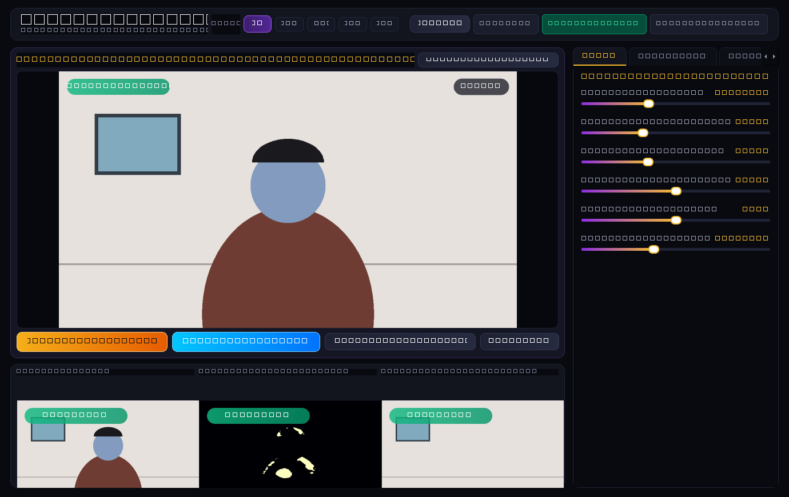
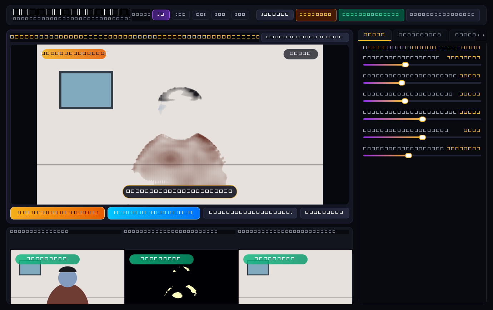
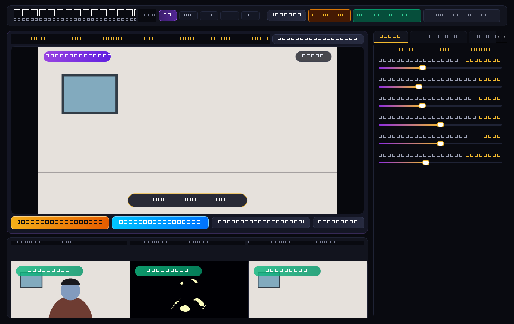
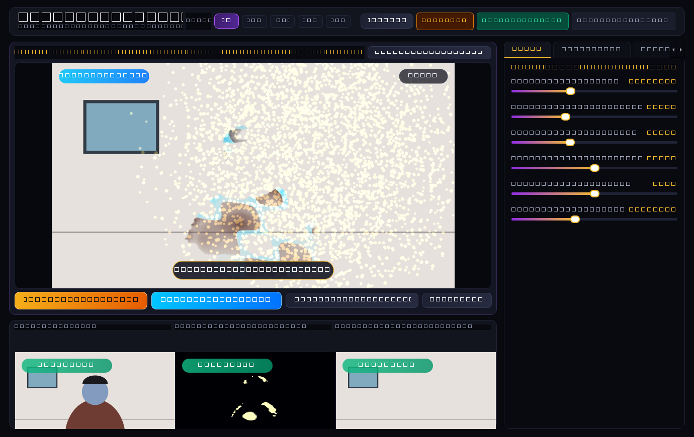
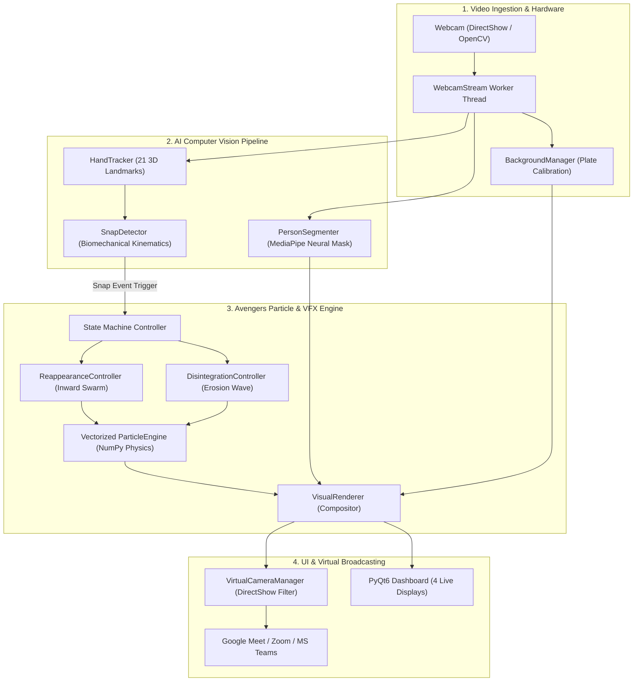
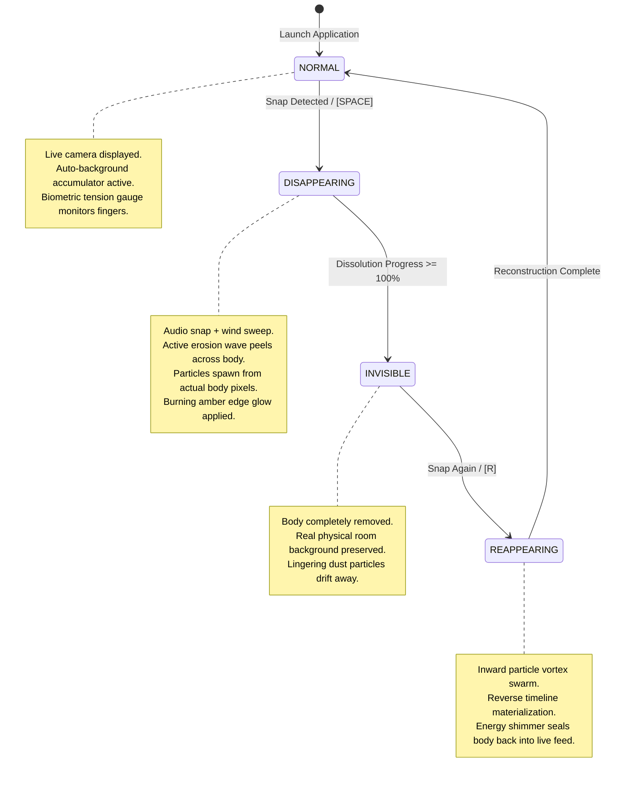

# SNAP DISAPPEAR – Real-Time Avengers Dust VFX ⚡

[](https://www.python.org/)
[](LICENSE)
[](https://opencv.org/)
[](https://developers.google.com/mediapipe)
[](https://www.riverbankcomputing.com/software/pyqt/)
[](https://github.com/letmaik/pyvirtualcam)

A professional, real-time computer vision and visual effects desktop application in Python that recreates the cinematic **Avengers: Infinity War** dust disintegration effect triggered by snapping your fingers in front of your laptop webcam.

When you snap your fingers, your body dynamically disintegrates into thousands of organic, glowing dust, ember, and ash particles that drift away into the wind, leaving your physical room background completely visible and preserved. Snapping again triggers an inward reverse particle vortex that reconstructs your body back into the live video feed.

The application includes direct **Virtual Camera** output (`pyvirtualcam`), allowing you to use this effect live in **Zoom**, **Google Meet**, and **Microsoft Teams**.

---

## 📸 Visual Showcase & Application States

| 1. Normal Live View | 2. Dust Disintegration in Action |
| :---: | :---: |
|  |  |
| *Live camera feed with character presets and biometric HUD.* | *Body dissolving into thousands of glowing golden embers & ash.* |

| 3. Pure Preserved Room Background | 4. Reverse Particle Reconstitution |
| :---: | :---: |
|  |  |
| *Body completely removed; physical room background preserved.* | *Reverse particle swarm swirling back to reform the body.* |

---

## 🏛️ System Architecture

The application is structured into decoupled, high-performance modular layers separating video ingestion, neural detection, vectorized simulation, compositing, broadcasting, and UI dispatch.



### 🔁 Finite State Machine (FSM)



---

## 📁 Complete Project Structure

```
snap-finger & Disappear/
│
├── main.py                         # Application entrypoint & CLI argument parser
├── config.py                       # Global settings, constants, character presets, asset paths
├── requirements.txt                # Production Python dependencies
├── run.bat                         # 1-click Windows desktop launcher
├── LICENSE                         # Official MIT Open-Source License (2026)
├── README.md                       # Comprehensive system documentation & user guide
├── .gitignore                      # Git exclusion rules (build caches, large binaries)
│
├── camera/                         # Video Hardware & Streaming Layer
│   ├── __init__.py                 # Package init
│   ├── webcam.py                   # Threaded OpenCV capture with auto-reconnection
│   ├── virtual_camera.py           # PyVirtualCam output stream (OBS Virtual Camera backend)
│   └── background_capture.py       # Auto-accumulator & clean room background preservation
│
├── detection/                      # AI Computer Vision & Kinematics Layer
│   ├── __init__.py                 # Package init
│   ├── hand_tracking.py            # MediaPipe HandLandmarker wrapper (21 3D landmarks, dual hands)
│   ├── snap_detector.py            # Biomechanical finger-snap kinematics & velocity engine
│   └── person_segmentation.py      # MediaPipe neural selfie segmentation with edge feathering
│
├── effects/                        # Particle Physics & Compositing Layer
│   ├── __init__.py                 # Package init
│   ├── particle_engine.py          # Vectorized NumPy particle simulation (dust, ash, glowing embers)
│   ├── disintegration.py           # Wave-front peeling erosion & burning edge glow
│   ├── reappearance.py             # Reverse particle vortex & body materialization
│   ├── visual_renderer.py          # Master VFX compositor & state machine
│   └── audio_manager.py            # Low-latency asynchronous sound player (snap, disintegrate, reappear)
│
├── interface/                      # PyQt6 User Interface Layer
│   ├── __init__.py                 # Package init
│   ├── styles.py                   # Quantum Realm dark theme stylesheet (QSS)
│   ├── controls.py                 # Custom video monitors, biometric gauge, sliders, status pills
│   └── dashboard.py                # Main PyQt6 window with 4 live previews, tabs, presets, HUD
│
├── assets/                         # Local Assets (100% Offline)
│   ├── models/                     # Pre-downloaded MediaPipe neural task bundles
│   │   ├── hand_landmarker.task             # Hand tracking model (7.8 MB)
│   │   ├── selfie_segmenter.tflite          # Lightweight segmentation (250 KB)
│   │   └── selfie_multiclass_256x256.tflite # High-definition multiclass model (16.3 MB)
│   ├── sounds/                     # Synthesized 44.1kHz 16-bit PCM WAV audio effects
│   │   ├── snap.wav                # Crisp snap transient with high-frequency pop & cosmic chime
│   │   ├── disintegrate.wav        # Wind sweep, rumble, and crackling ember dissipation
│   │   └── reappear.wav            # Reverse harmonic swell & energy lock-in pulse
│   └── screenshots/                # Real captured application interface state images
│       ├── 01_dashboard_normal.png
│       ├── 02_vfx_disintegration.png
│       ├── 03_vfx_invisible.png
│       └── 04_vfx_reconstruction.png
│
└── tests/                          # Automated Unit Test Suite
    ├── __init__.py                 # Package init
    ├── test_snap_detector.py       # Kinematic tests (priming, separation speed, cooldown, handedness)
    └── test_particle_engine.py     # Particle physics, buffer allocation, & rendering tests
```

---

## 🔬 Core Engineering & Physics Principles

### 1. Biomechanical Snap Gesture Detector
A human finger snap is not merely bringing two fingers together; it involves distinct muscular phases:
* **Contact & Compression (`PRIMED`)**:
  Thumb pad (`Landmark 4`) and middle finger pad (`Landmark 12/11`) press together firmly. Hand size is normalized:
  $$\text{HandScale} = \|\mathbf{P}_{\text{Wrist}} - \mathbf{P}_{\text{MiddleMCP}}\|$$
  Normalized contact distance must be $< 0.125$, held for consecutive frames.
* **Explosive Release & Downward Stroke (`SNAP`)**:
  The middle finger rapidly slips off the thumb with separation velocity:
  $$\text{Velocity} = \frac{\Delta d}{\Delta t} > v_{\text{threshold}}$$
  Simultaneously, the middle fingertip strokes inward toward the palm/wrist (`Landmark 0`), while the index finger remains unclasped.
* **Debounce Cooldown**:
  A 1.25s debounce cooldown timer prevents accidental repeated triggers.

### 2. Avengers Dust Disintegration VFX
* **Pixel Color Sampling**: Particles sample their base color directly from the actual RGB pixels of your clothes, skin, and hair at the exact moment of dissolution.
* **Mixed-Media Particle Composition**:
  - *Sampled Body Fragments* (65%): Wardrobe and skin colors with contrast boost.
  - *Golden Glowing Embers* (20%): Additive bloom blending with high-energy amber cores (`RGB 255, 200, 60`).
  - *Dark Carbon Ash* (15%): Flaky charcoal gray particles (`RGB 45, 45, 50`).
* **Aerodynamic Turbulence**: Particles are updated using dual-sine curl noise:
  $$v_x(t) = v_{\text{wind}, x} + \sin(0.015 y + \text{seed} + 3.5 t) \cdot \tau$$
  $$v_y(t) = v_{\text{thermal}, y} + \cos(0.015 x + \text{seed} + 3.0 t) \cdot (0.75 \tau)$$
* **Peeling Erosion Wave**: Body dissolves progressively from the snap location outwards, accompanied by an intense orange/gold burning ember rim.

### 3. Background Preservation
* **True Room Integrity**: When you disappear, only the person is removed. The physical furniture, walls, and lighting behind you remain visible.
* **Dual Capture Modes**:
  1. *Automatic Accumulator*: Continuously samples unoccluded background pixels as you naturally move.
  2. *Instant Calibration*: Step out of frame for 1 second and press <kbd>B</kbd> (or click **Lock Background**). Missing occluded areas are automatically filled using edge-aware inpainting (`cv2.INPAINT_TELEA`).

---

## 🎨 Infinity Stone Character Presets

Switch presets live via the top header chips to dynamically alter the particle aesthetics:

| Character Preset | Core Color | Secondary Color | Physics Style |
| :--- | :--- | :--- | :--- |
| **🪐 Thanos (Infinity War)** | Glowing Amber (`#f3ba2f`) | Hot Orange (`#ff6b35`) | High-velocity upward drift & dark ash flakes |
| **🔮 Doctor Strange (Mystic)** | Eldritch Spark (`#ff8c00`) | Bright Gold (`#ffd700`) | High aerodynamic turbulence & intense bloom |
| **🕷️ Spider-Man (Emotional)** | Soft Amber (`#f6ad55`) | Carbon Ash (`#4a5568`) | Gentle floating motes with slow decay |
| **🔴 Scarlet Witch (Chaos)** | Crimson Red (`#e53e3e`) | Chaos Magenta (`#b83280`) | Swirling hex energy embers |
| **🔷 Space Stone (Cosmic)** | Celestial Cyan (`#00f0ff`) | Electric Cobalt (`#3182ce`) | Rapid stardust dispersal |

---

## 🚀 Quick Start Guide

### 1. Installation
Clone this repository and install dependencies:
```bash
git clone https://github.com/ABIZER-web/snap-finger-Disappear.git
cd snap-finger-Disappear
pip install -r requirements.txt
```

### 2. Launch the Application
Simply double-click **`run.bat`** on Windows or execute:
```bash
python main.py
```

Optional CLI parameters:
```bash
python main.py --camera 0 --width 1280 --height 720 --sensitivity 0.75 --particles 12000
```

---

## 🌐 Virtual Camera Setup for Meetings

Broadcast the real-time Avengers dust disintegration directly into **Google Meet**, **Zoom**, and **Microsoft Teams**.

### Driver Setup (One-Time)
1. Run **`OBS-Studio-Installer.exe`** (or install OBS Studio from [obsproject.com](https://obsproject.com/)).
2. Open OBS Studio once, click **Start Virtual Camera** (bottom right controls), then close OBS. *(This registers the Windows DirectShow virtual camera driver).*
3. In Snap Disappear, click **🌐 Enable Virtual Camera**. The status badge will turn green: `VIRTUAL CAM: ACTIVE`.

### Meeting Software Configuration:

#### Google Meet:
1. Join or start a Google Meet call.
2. Click **More Options** (3 vertical dots at bottom) → **Settings** → **Video**.
3. Under **Camera**, select **OBS Virtual Camera**.

#### Zoom:
1. Open Zoom Settings → **Video**.
2. Under **Camera**, choose **OBS Virtual Camera**.
3. *(Optional)* Uncheck *Mirror my video* (Snap Disappear already mirrors your preview naturally).

#### Microsoft Teams:
1. In Teams, click your profile icon → **Settings** → **Devices**.
2. Under **Camera**, choose **OBS Virtual Camera**.

---

## 🎮 Controls & Keyboard Shortcuts

| Control | Shortcut | Function |
| :--- | :---: | :--- |
| **Finger Snap** | *Gesture* | Snap fingers in front of webcam to disappear or reappear |
| **Disappear** | <kbd>SPACE</kbd> | Manual hotkey to trigger particle disintegration |
| **Reappear** | <kbd>R</kbd> | Manual hotkey to trigger reverse particle reconstruction |
| **Lock Background** | <kbd>B</kbd> | Calibrates clean physical room background plate |
| **Fullscreen** | <kbd>F11</kbd> | Toggles edge-to-edge cinematic theater mode |
| **Exit** | <kbd>ESC</kbd> | Safely releases camera hardware and closes application |
| **Emergency Restore** | *Button* | Instantly reverts to normal live webcam feed |

---

## 🧪 Automated Testing

Run the full unit test suite covering kinematics, sensitivity thresholds, cooldowns, and particle physics:
```bash
python -m unittest discover tests
```
Output:
```text
Ran 8 tests in 0.343s
OK
```

---

## 📄 License & Copyright

This project is licensed under the **MIT License** — see the [LICENSE](LICENSE) file for details.

```text
Copyright (c) 2026 ABIZER-web
```
Inspired by Marvel Studios' *Avengers: Infinity War* & *Avengers: Endgame*. Built with ❤️ for computer vision engineers and VFX creators.
